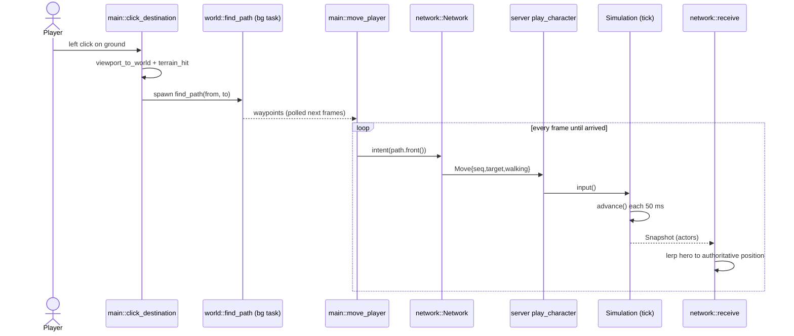
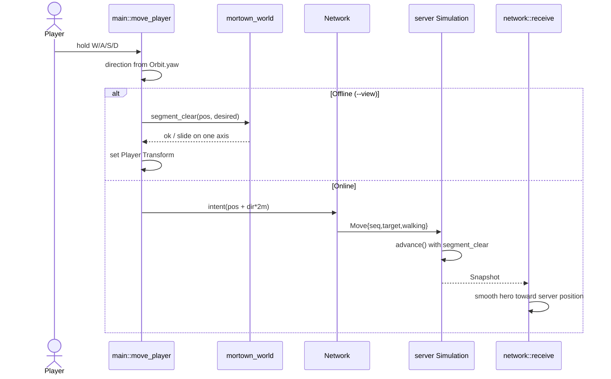
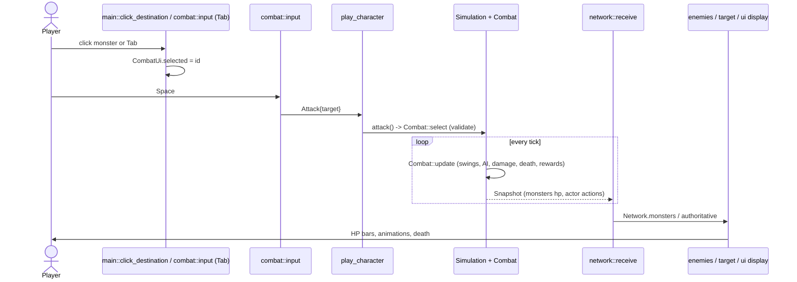
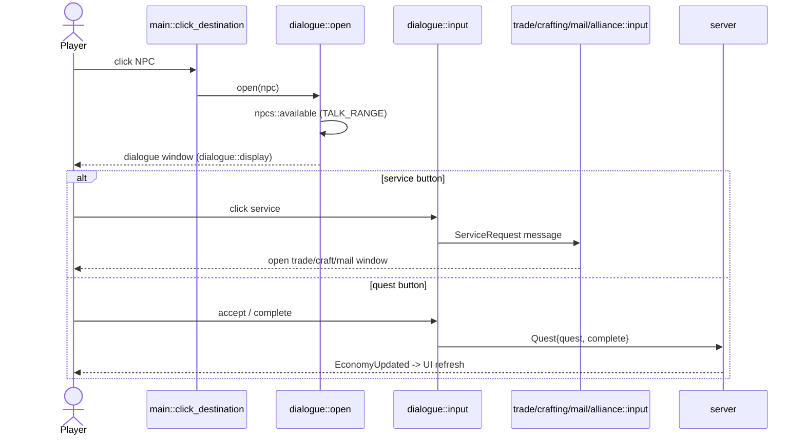
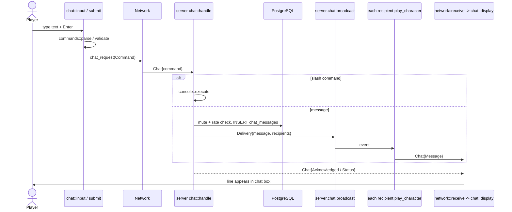
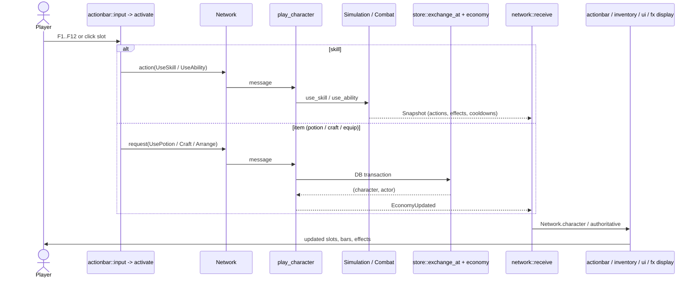
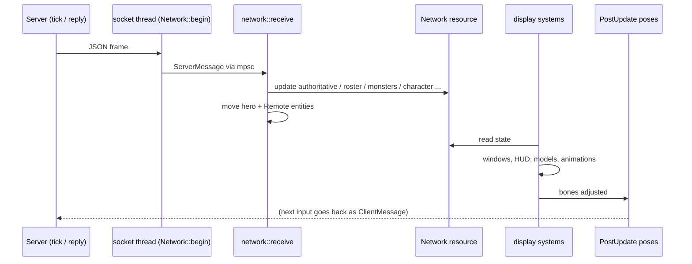

# Mortown — Key Flows

Step-by-step traces from player input to what appears on screen. Paths are relative to `crates/`.
"Frame" = one run of the client `Update` chain (see `ARCHITECTURE.md` §3.3). "Tick" = one 50 ms server step.

Common pieces used by every online flow:
- `client/src/network.rs::Network` — resource holding the connection and the latest server state (`authoritative`, `roster`, `monsters`, `residents`, `character`, `chat`…).
- Helpers that send a `ClientMessage`: `Network::intent` (movement, rate-limited), `action` (combat, fire-and-forget), `request` (economy, sets `pending` until the server replies), `chat_request`, `party_request`, etc.
- Socket thread in `Network::begin` forwards messages both ways; `network::receive` drains replies once per frame.
- Server: `server/src/lib.rs::play_character` — one async loop per connected player that parses messages and sends replies/snapshots.

---

## 1. Click on the ground → character walks there

1. `client/src/main.rs::click_destination` — on left click: ignores the click if a dialog/drag/character window is open, or the cursor is over HUD (`actionbar::contains`).
2. Same function — first tries to pick an actor (monster, player, NPC) under the cursor; if one is found, flow 3/4 applies instead.
3. `Camera::viewport_to_world` turns the cursor into a 3D ray; `main.rs::terrain_hit` ray-marches it against `World::surface_height` and refines the hit with 14 bisection steps.
4. If the player has the admin `click_teleport` power → `Network::teleport` → server `Simulation::click_teleport`. Otherwise:
5. `Movement.destination = hit`, and `world/src/navigation.rs::find_path(from, to)` is spawned on `AsyncComputeTaskPool` (background thread) → `Movement.pending`.
6. `main.rs::move_player` (later frames) polls the task; on success stores waypoints in `Movement.path`; on failure shows "no path".
7. **Online:** `move_player` drops waypoints closer than 0.15 m to the server position and calls `Network::intent(time, path.front(), walking)` → `ClientMessage::Move{seq,target,walking}` (at most every 45 ms).
8. Server `play_character` → `simulation.rs::Simulation::input` (checks target is finite and inside the world, `seq` is newer) → each tick `simulation.rs::advance` moves the player up to `RUN_SPEED × TICK_SECONDS` toward the target using `World::segment_clear`.
9. Tick loop in `Server::new` publishes `ServerMessage::Snapshot`; `play_character` forwards it.
10. `network::receive` stores `authoritative` and pulls the hero `Transform` toward it (exponential smoothing, rate 25), snapping to ground height.
11. `move_player` shows the `DestinationMarker` ring; `character::animate` picks the run/walk animation; `update_camera` follows.
12. **Offline:** step 7–10 are replaced by `move_player` moving the `Player` transform itself along the path.

---

## 2. WASD movement (offline vs online)

1. `main.rs::move_player` builds `input` from W/A/S/D (zeroed if the character window is open). Any key press cancels a click route.
2. Converts input to a world direction using the camera yaw (`Orbit.yaw`): `right` and `forward` vectors, normalized.
3. Speed: 10 m/s run (default), 5 m/s with Shift (walk).
4. **Online** (`Network.mode == Online`):
   - Target = server position + direction × 2 m ("carrot" in front of the player).
   - `Network::intent` → `Move{walking: speed < 7}` → server `Simulation::input` → `advance` (same as flow 1, steps 8–10).
   - The client never moves the hero itself; `network::receive` smooths toward the server position. If you stop pressing keys, the server stops you after 10 ticks without input.
5. **Offline** (`--view` preview only):
   - `desired = pos + direction × speed × dt` (dt capped at 0.1 s).
   - `World::segment_clear` checks collision; if blocked, tries moving along X only, then Z only (wall sliding).
   - Sets `Transform` Y to `surface_height`, rotates to face movement.

---

## 3. Selecting and attacking a monster

Selection (client only):
1. Click: `main.rs::click_destination` projects each live monster within 60 m and in line of sight (`World::sight_clear`) to the screen as a feet→head segment; the closest one under the cursor wins → `combat::CombatUi.selected = Some(monster_id)`.
2. Or Tab: `combat.rs::input` cycles `selected` through monsters sorted by distance.
3. `target.rs::display` shows the target frame; `combat.rs::display` shows name/HP/distance.

Attack:
4. Space → `combat.rs::input` → `Network::action(ClientMessage::Attack{target})` (pressing again on the current target sends `None` = stop). Keys 1/2 → `UseSkill` / `UseSecondary`; F1–F12 see flow 6.
5. Server `play_character` → `Simulation::attack` → `combat.rs::Combat::select` validates the target (you and the mob alive, within weapon range, no obstacle via `World::segment_clear`) and stores `actor.attack_target`. Errors go back as `ServerMessage::Error` and into `actor.combat_status`.
6. Each tick: `Simulation::update` → `Combat::update` runs auto-attack swings, monster AI/retaliation, damage (`combat::damage`, `hit_chance`), deaths; `Combat::resolve_rewards` gives XP/loot.
7. Snapshot carries updated `monsters` (hp, effects, attack motion, `death_ms`) and the player's `Actor` (hp, `actions`, `combat_status`, cooldowns). When kills change, `play_character` saves via `store::save`.
8. `network::receive` copies them into `Network`; also updates `character.stats` (level, HP…) from `actor.progress`.
9. Display: `enemies::sync` spawns/updates monster models, `enemies::pose` animates strikes/falls, `player_motion::*` + `action_fx::*` play the hero's attack animation and projectiles, `target::display` / `ui::update` update bars.

---

## 4. Talking to an NPC (dialogue)

1. Click on an NPC: `main.rs::click_destination` picks it (NPC must be in the same room, ≤ 60 m, visible) → `CombatUi.npc = Some(id)`, sends `Attack{target: None}` (stop fighting).
2. `client/src/dialogue.rs::open` → `npcs::available` checks distance (`world/src/npcs.rs::TALK_RANGE`) and room. Too far → status "come closer". Otherwise opens `ui::CharacterWindow { open, dialogue: true, npc }` and clears the click route.
3. `dialogue.rs::display` shows the window: heading from `Npc.name` + role, text = `Npc.greeting` (`world/src/npcs.rs::RESIDENTS`) or, for the plaza trader, the current quest text from `protocol/src/quests.rs`. Service buttons are visible if `npcs::offers(npc, service)`.
4. `dialogue.rs::input`:
   - Esc / close / walking out of range / C,I,K,M,J,T → closes.
   - Service button → writes a `npcs::ServiceRequest` message; `trade::input`, `crafting::input`, `mail::input`, `alliance::input` read it and open their windows.
   - Quest button → `Network::request(ClientMessage::Quest{quest, complete})` → server economy path (as in flow 6, potion) → `EconomyUpdated`.
5. Dialogue itself is client-only; only quest/trade actions reach the server, which re-checks the NPC exists and distance.

---

## 5. Sending a chat message

1. Enter → `client/src/chat.rs::input` focuses the field; keystrokes go into `chat::Form.draft` and are hidden from game hotkeys (this system runs before all other inputs).
2. Enter again → `chat.rs::submit`:
   - `protocol/src/chat/commands.rs::parse(text)` — a `/command` becomes `chat::Command::Admin{text, target}` (with the selected target from `CombatUi`).
   - Text starting with `"` → `Command::Whisper{nickname, text}`.
   - Otherwise `Command::Send{channel, text}` after `chat::validate` (length, no control chars).
3. `Network::chat_request` → `ClientMessage::Chat{command}`; sets `chat.pending` so you can't double-send.
4. Server `play_character` (limit 4 chat actions per second) → `server/src/chat.rs::handle`:
   - Commands → `console.rs::execute`.
   - Send/Whisper: re-validate, compute recipients (all / local radius / group / alliance / private), check mutes and rate limit (1/s, 5 per 10 s) in a DB transaction, `INSERT` into `chat_messages`, then broadcast `Delivery` on `server.chat`. Reply `Acknowledged` to the sender.
5. Every recipient's `play_character` receives the broadcast, filters by recipients/ignore list, sends `ServerMessage::Chat{Reply::Message}`.
6. `network::receive` → `chat::Log::receive` stores it (last 100) → `chat.rs::display` renders the lines.

---

## 6. Using an inventory item / a skill from the action bar

1. F1–F12 key or click on a slot → `client/src/actionbar.rs::input` → `actionbar.rs::activate(binding, network, combat)`. The binding (`u64`) comes from the character's hotbar layout (`protocol/src/layout.rs`).
2. `activate` decides by binding:
   - **Skill 1–6**: self/area abilities (no target needed) → `UseAbility{skill, target: None}`. Otherwise auto-selects the nearest live monster if nothing is selected, then `UseSkill` (1), `UseSecondary` (2) or `UseAbility{skill, target}`.
   - **Potion** (item kind 8) → `Network::request(UsePotion)`.
   - **Recipe** → `Craft{recipe, expected, specialization_revision}`.
   - **Equippable item** → `Arrange{source, target: Model or Bag}` (equip/unequip).
3. Skills: server `Simulation::use_skill / use_secondary / use_ability` → `Combat` checks cooldown, mana/stamina, target; damage/effects resolve over ticks; visible through `Snapshot` (`actions`, `effects`, cooldowns, ground `areas`).
4. Items: server `play_character` cancels any open player exchange, then `store::exchange_at` runs `economy.rs` rules inside a DB transaction → updates the live actor (`Simulation::replace_actor`) → replies `ServerMessage::EconomyUpdated{character, actor}` (or `Error`).
5. `network::receive` replaces `network.character` and `authoritative`, clears `pending`.
6. Display: `actionbar::display` (counts, cooldown), `inventory::display`, `ui::update` (HP after potion), `skill_effects::display` (ground areas), `action_fx::spawn` (projectiles), `appearance::display` (new weapon on the model).

---

## 7. Server answer → what you see

This is the general pattern behind every flow above.

1. Socket thread (`Network::begin`) parses each JSON frame into `ServerMessage` and pushes it into an `mpsc` channel.
2. `network::receive` (2nd step of the `Update` chain) drains the channel and updates `Network`:
   - `Welcome` → sets `character`, `authoritative`, teleports the hero, `mode = Online`.
   - `Snapshot` → `authoritative` (own actor), `roster` (all players), `monsters`, `residents`, `areas`; recalculates level/HP stats in `character`.
   - `EconomyUpdated` / `CharacterUpdated` → new `character` (+ actor).
   - `Chat/Party/Alliance/Mail/Exchange` → their sub-states (`chat`, `party`…).
   - `Error` → `status` text; `fatal` → disconnect. `Closed` → back to menu.
3. Same system also moves entities: hero toward `authoritative.position`; spawns/despawns/moves `Remote` entities (other players, model `adventurer.glb`) from `roster`.
4. Later systems in the same frame read `Network` and redraw: window `*::display` systems, `npcs::sync` and `enemies::sync` (spawn models for residents/monsters), `appearance::*` / `ancestry::*` (equipment & body), `player_motion::sync` / `action_fx::spawn` (attack animations from `actor.actions`), `ui::update` (HUD), `target::display`.
5. `PostUpdate` pose systems adjust skeleton bones, then Bevy renders the frame.

