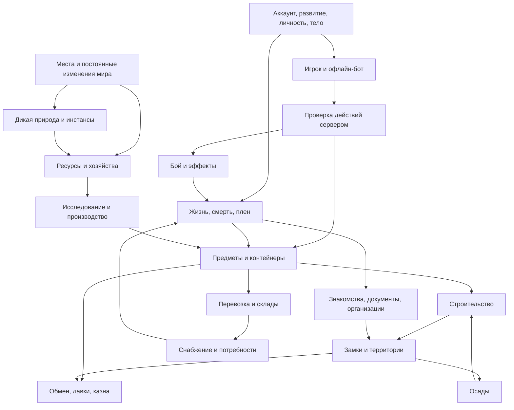

# Связи систем и проверка концепции

Дата: 2026-10-10. Основание — актуальные документы `game-design/`.
Это анализ утверждённых механик. Способы реализации и проверки ниже имеют
статус **[PROPOSAL]**; они не добавляют игровой канон.

## Вывод

Основы достаточно для проектирования общего устройства сервера.
Главные зависимости проходят через существование предметов, смену
личности, физическое присутствие и изменения постоянного мира.
Проектирование можно продолжать без новой общей анкеты. Оставшиеся
локальные решения нужно закрывать перед реализацией соответствующей функции.

Текущий код в этой работе не проверялся: по просьбе автора изучались
Markdown-документы. Здесь нет заключений о готовности существующей реализации.

## Карта зависимостей

Стрелка означает «предоставляет данные или механизм», а не порядок разработки.

Сохранение мира, сетевое представление и контроль доступа нужны всем узлам.
Их не следует добавлять только после готовности отдельных механик.

## Основные связки

### 1. Развитие персонажа и смена личности

Основание: [смерть](character/death.md), [прогрессия](character/progression.md),
[узнавание](society/identity-recognition.md), [документы](society/factions-law-documents.md).

Знания и часть прогрессии переживают смерть; старая личность — нет.
Если хранить всё под одним понятием «персонаж», новая личность может
случайно получить старые знакомства, права доступа и документы.

**[PROPOSAL]** Разделить постоянную линию развития, отдельные личности и
физические тела. Сохранение изученного не должно автоматически переносить
социальные связи. Порядок оформления членства новой личности — отдельное
правило; техническое разделение позволяет не предрешать его.

Проверка: после смерти сохраняются предусмотренные знания и экипировка,
а труп, исчезновение ключей и документы старой личности обрабатываются
отдельно. Копии сохранённых вещей не появляются одновременно у трупа и новичка.

### 2. Один предмет во всех состояниях

Основание: [экономика](economy/economy-trade-logistics.md),
[транспорт](transport/transport-naval.md), [крафт](economy/crafting-research.md).

Сундук, груз на карете, товар лавки и предмет инвентаря не должны быть
несвязанными копиями одного товара. Особенно опасны одновременная покупка,
ограбление, смерть продавца, затопление корабля и отключение клиента.

**[PROPOSAL]** Единственное текущее местонахождение предмета и общий
механизм перемещения. Защищённый обмен меняет владение товаром и оплатой
одной операцией; доставка к месту сделки остаётся физической.

Проверка: два покупателя не приобретают один экземпляр; повтор запроса
после разрыва связи не повторяет покупку. Телепортация несёт тот же
инвентарь, не создаёт копию и не переносит оставленный в мире груз.

### 3. Выход из игры не создаёт другого существа

Основание: [офлайн-персонажи](character/offline-characters.md),
[плен](society/crime-captivity.md), [потребности](character/needs-health.md).

**[PROPOSAL]** Игрок и бот управляют одним телом через общие действия.
Переключение управления не сбрасывает плен, ранения, вещи или позицию.
Бот прекращает действия связанным; после развязывания возобновляет их.
Исчезновение по окончании срока бота — отдельное состояние присутствия.

Проверка: одновременно управляет только один источник; опоздавшее
сообщение старой сессии не действует после нового входа. Появление
персонажа после отсутствия не создаёт второго тела.

### 4. Право, доступ и владение территорией различаются

Основание: [фракции](society/factions-law-documents.md),
[война](combat/combat-war-sieges.md), [строительство](construction/construction.md).

Документ о собственности, физический ключ, территория фракции и возможность
разрушить стену описывают разные отношения. Смена флага не должна сама
исполнять все имущественные решения победителя. Социальный договор не
должен превращаться в технический запрет нарушить обещание.

**[PROPOSAL]** Отдельно хранить документы, доступ, замковый суверенитет
и фактическое присутствие. Правило осады проверять при захвате владения;
разрушение строений обрабатывать независимо от наличия осады.

Проверка: уничтожение замка прекращает его владение; запоздавшее событие
победы в осаде не возвращает уже уничтоженный замок. Уход фракции с земли
без замка не оставляет вечную запись о владении этой землёй.

### 5. Производство связывает мирную жизнь с войной

Основание: [сельское хозяйство](economy/agriculture.md),
[потребности](character/needs-health.md), [крафт](economy/crafting-research.md).

Еда, сырьё, строительные компоненты, боеприпасы, транспорт и услуги
создают взаимную потребность мирных и военных игроков. Проверять нужно
всю цепочку: получить сырьё → изготовить → сохранить → доставить →
продать → использовать. Отдельно работающий станок этого не доказывает.

**[PROPOSAL]** Одинаковые производственные операции для ручной работы
и разрешённых действий бота. Результат привязан к версии чертежа,
материалам и правилам расчёта. Исследование и изготовление по чертежу
разделены, как и знание чертежа и его бумажный носитель.

### 6. Деньги: создание и обращение

Основание: [экономика](economy/economy-trade-logistics.md).

Основной приток связан с добычей золота, дополнительный — вводом автором;
монеты также присутствуют в PvE-луте. Торговля и налоги перераспределяют
уже существующие деньги. Ошибка здесь может незаметно умножать денежную массу.

**[PROPOSAL]** Технически различать создание денег, перемещение и
уничтожение. У каждого изменения — причина и источник. Автоматический
налог переносит сумму в физическую казну; он не создаёт вторую сумму.
Учёт не вводит безналичный игровой кошелёк или новый налог.

Процесс изготовления монет из добытого золота ещё не описан. Это
локальная граница для будущей реализации, а не повод снова спрашивать
про уже восстановленный основной источник денег.

### 7. Непрерывность мира и расширение контента

Основание: [география](world/geography-resources.md), [PvE](world/pve.md),
[принципы](01_CORE_PRINCIPLES.md).

Начальный мир создан заранее, игроки его меняют, регионы добавляются,
послерелизных вайпов нет. Обновление исходной карты не должно повторно
поставить разрушенные дома или перезаполнить выработанную шахту.

**[PROPOSAL]** Разделить исходные данные региона и сохранённое состояние
мира. Обновления проходят через миграции данных. Инстансы принадлежат
тому же серверному миру: переход туда не равен межсерверному переносу
и не должен клонировать уникальный предмет.

### 8. Информация — часть игрового мира

Основание: [RP и общение](society/roleplay-rules.md),
[узнавание](society/identity-recognition.md), [почта](society/factions-law-documents.md).

Клиенту нужна доступная персонажу информация. Настоящее имя под маской,
содержимое закрытого письма и чужого сундука не должны передаваться
лишь потому, что интерфейс временно их скрывает.

**[PROPOSAL]** Отдельные серверные представления для владельца,
свидетеля и получателя сообщения. География карты может быть известна,
не раскрывая всех текущих людей и событий. Голос и текст учитывают
правила слышимости; птичья почта опирается на физический документ.

## Риски, которые проверяются прототипами

Это инженерная оценка, не новые запреты для игроков.

1. **Свободное проектирование изделий.** Реализовать понятную оценку
   разных конструкций сложнее, чем редактор внешности. Нужен опытный
   образец расчёта: несколько осмысленно разных форм действительно
   дают разные свойства; заведомо плохая форма не становится лучшей.
   Нельзя считать задачу решённой только наличием ползунков.
2. **Разрушение, корабли и осады.** Изменяемая геометрия затрагивает
   коллизии, навигацию, видимость, синхронизацию и сохранение. Проверять
   обвал и движущийся груз до масштабного наполнения городов.
3. **Офлайн-население.** Число тел в мире не равно числу подключённых
   клиентов. Нужны замеры стоимости поведения, пути и хозяйственных
   таймеров с большим числом ботов, а не только тест пустого сервера.
4. **Долговечные предметы и непрерывная эмиссия.** Отсутствие износа
   оружия, сохранение инвентаря и отсутствие вайпов могут накапливать
   снаряжение и богатство. Измерять спрос, повторные покупки и концентрацию
   денег. Не вводить износ, вайпы или денежные изъятия без решения автора.
5. **Плен и ограниченные жизни.** Проверить совместно питание, офлайн,
   длительное заключение и потерю прогресса. Наблюдать доступные действия
   пленника и реальные возможности спасения. Это ещё не заключение,
   что канон нужно смягчать, и не завершённый аудит игровых ощущений.

## Границы неопределённости

**[OPEN]** Для завершения отдельных функций потребуются конкретные
политики: имущество при окончательном удалении после последней жизни;
поведение входа в точку, которую за отсутствие перестроили; процесс
получения монет из золота; признание постройки замком и разрешение
перекрывающихся замковых владений; статус членства при смене личности.
Документы не дают достаточно точного ответа на эти переходы.

Это не препятствует разделению сущностей и интерфейсов. Не вводить
ответ молча. Сначала сформулировать конкретный случай в соответствующем
этапе разработки, проверить канон и предложить решение; вопрос автору
нужен только там, где останется выбор игрового поведения.

Отдельно уже зафиксированы [открытые и отложенные темы](90_OPEN_QUESTIONS.md).
Числа баланса не блокируют устройство данных, но временные значения
прототипов должны явно отличаться от утверждённых правил.

Далее: [архитектурная основа](03_ARCHITECTURE_FOUNDATION.md) и
[порядок реализации](04_IMPLEMENTATION_ROADMAP.md).
