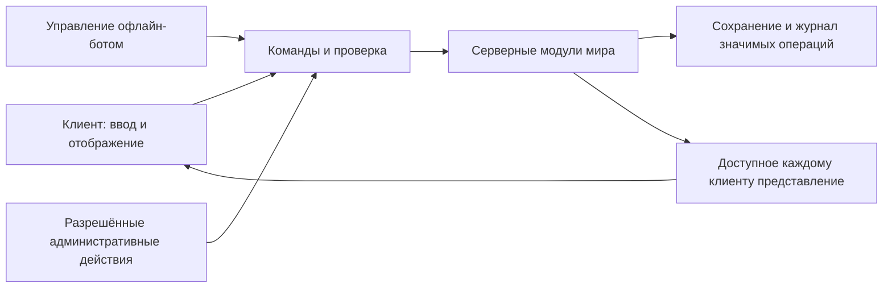

# Архитектурная основа

Дата: 2026-10-10. Статус документа: **[PROPOSAL]**.
Это целевое техническое устройство по утверждённому дизайну, а не
описание уже работающего кода. Имена сущностей ниже условные, не
предписание немедленно создавать соответствующие файлы или сервисы.

Основание: [карта зависимостей](02_SYSTEM_DEPENDENCIES.md),
[принципы](01_CORE_PRINCIPLES.md), [контекст](../PROJECT_CONTEXT.md).
Все игровые правила берутся из документов подсистем; этот план их не заменяет.

## 1. Начальная форма приложения

Предлагается сервер с явно разделёнными внутренними модулями. Модули
не требуют отдельных сетевых сервисов. Начать с одного обслуживаемого
серверного мира и одного процесса симуляции, если аудит существующего
кода не выявит веской причины выбрать другую начальную форму.

Клиент отображает мир, принимает ввод, предсказывает допустимое движение
для отзывчивости. Итоговое состояние определяет сервер. Клиент отправляет
намерение «взять», «купить», «атаковать», а не готовый результат «добавить
предмет», «списать чужие деньги», «убить персонажа».

Rust и Bevy заданы проектом. Конкретные версии библиотек, транспорт,
база данных и существующие границы crates здесь не выбирались: для этого
нужен следующий этап с чтением реального кода. План не требует смены стека.

Административные действия имеют собственные полномочия, но сохраняют
целостность мира. Технический журнал не является публичной хроникой и
не устанавливает политических ограничений для автора.

## 2. Идентичность и время жизни данных

Разделить следующие понятия:

- **AccountId** — доступ к серверу и допустимые сессии. Несколько
  оплаченных аккаунтов одного человека разрешены каноном.
- **CharacterId** — линия развития с ограниченными жизнями,
  характеристиками, талантами и изученными возможностями.
- **PersonaId** — конкретная личность внутри мира. Имена, документы
  и адресованные ей социальные связи не тождественны аккаунту.
- **BodyId** — физическое тело с позицией, здоровьем и состоянием плена.
  После смерти остаётся отдельный труп, пока действует правило его существования.
- **SessionId / версия управления** — кто сейчас посылает действия.
  Смена сессии не меняет игровую личность и не порождает второе тело.

Постоянные идентификаторы не должны зависеть от временного номера
сущности внутри Bevy. При загрузке строится соответствие сохранённых
объектов сущностям текущего процесса. Удалённый идентификатор не выдаётся
новому предмету или человеку: иначе старый ключ или документ может
случайно начать ссылаться на другого владельца.

Окончательное удаление персонажа запрещает его дальнейшее использование.
Ссылки в истории чужих предметов или документов не должны становиться
ссылками на нового персонажа. Техническое сохранение факта удаления не
равно доступной для игры сохранённой личности.

## 3. Состояния персонажа

Хранить отдельные оси состояния, а не один большой список комбинаций:

- Жизнь: жив / нокдаун / умер / окончательно завершён.
- Управление: сессия игрока / офлайн-бот / нет управления.
- Присутствие: в мире / отсутствует после истечения срока бота.
- Ограничения: связан, ослеплён повязкой и другие утверждённые состояния.

Сервер проверяет допустимые сочетания: мёртвое тело не торгует, связанный
бот не работает, отсутствующий персонаж не исполняет задачи. Таймеры
хранятся явно и восстанавливаются после рестарта. Для остановки самого
сервера нужна определённая политика времени; нельзя незаметно считать
простой сервера обычным отсутствием игрока и начислять всё подряд.

Переход смерти — одна согласованная операция: защита от повторного
применения, списание жизни, изменение численной прогрессии, создание
трупа, обработка вещей и документов, завершение старой личности,
появление новой при оставшихся жизнях. Исходное правило финальной
смерти учитывается отдельной ветвью; судьба её имущества не додумывается.

Снаряжение может визуально присутствовать на трупе только без создания
вторых доступных для получения экземпляров сохранённых вещей.

## 4. Предметы, контейнеры и перемещения

**ItemInstance** содержит постоянный ID, описание вида/конструкции,
материалы, версию расчёта свойств и состояние конкретного экземпляра.
**Container** содержит предметы и ограничения вместимости.

У предмета в каждый момент одно местонахождение: контейнер, слот
экипировки или положение в мире. Контейнер может быть прикреплён к телу,
карете, кораблю либо зданию. Вложение не должно образовывать циклы.
Лимит монет проверяется отдельно от веса обычного инвентаря по канону.

Единая операция переноса проверяет источник, назначение, доступ,
вместимость и актуальность состояния. Обмен, покупка, погрузка, кража
и посмертное сохранение используют её с разными правилами допустимости.

Защищённая сделка хранит версии предложений и согласие участников.
Изменение предложения требует нового подтверждения. Перед завершением
проверяется наличие всех вещей и возможность принять результат.
Операция либо выполняется целиком, либо ничего не передаёт.
Резервирование на время сделки не должно создавать длительную защиту
вещей от ограбления: конфликтующее событие отменяет незавершённую сделку.

Деньги можно хранить как количество физических монет внутри контейнера,
без отдельной симуляции каждой мелкой монеты. Это техническая упаковка;
деньги по-прежнему можно перемещать и красть только через правила мира.
Расчёты сумм — целочисленные, с проверкой переполнения.

## 5. Доступ, документы и общество

Физический замок и ключ проверяют доступ. Документ содержит собственный
ID, содержание, подпись/печать и ссылки на участников. Серверная
подлинность не превращается в автоматическое исполнение договора.

Для документов старой личности нужен индекс связей: при смерти нельзя
проверять только её карман, если исчезновению подлежат документы,
находящиеся в других местах мира. Точный состав «связанных документов»
должен задаваться видами документов, не поиском имени в произвольном тексте.

Организации имеют тип и участников. Ограничение «одна организация на
тип» проверяется одновременно при вступлении, исключая две успешные
параллельные заявки. Фракция не становится универсальным типом для
торговой компании и ордена. Полный перечень типов пока не фиксируется.

Подписи знакомых принадлежат конкретной личности наблюдателя, а не
всему аккаунту. Сервер выдаёт подсказку узнавания при допустимых условиях.
Глобальный настоящий ник не является общедоступным полем представления.

## 6. Территория, строительство и пространство

**WorldId** отделяет независимые серверные миры; **RegionId** — регионы
одного мира; **SpaceId** — общую область или отдельный инстанс.
Разделение регионов для нагрузки не должно создавать независимые копии
одной территории с разными владельцами.

Строение состоит из размещённых компонентов, связей опоры и материала.
Замок с владением — отдельная роль постройки, а не свойство каждой стены.
Захват меняет суверенитет; разрушение меняет физическое состояние.
Эти действия связаны событиями, но одно не служит разрешением для другого.

При уничтожении замка обновить владение, связанные осады, территориальные
права и налоговую привязку в согласованном порядке. Фактическое присутствие
на земле без замка рассчитывается по текущему миру. Здесь не вводятся
таймер удержания, кнопка регистрации границы или обязательный флаг.

Повреждение и перестройка инвалидируют затронутые коллизии, навигацию,
опоры и акустические преграды. Полную карту не нужно пересчитывать из-за
одного блока. Будущий терраформинг подключается к тому же уведомлению
об изменении участка пространства.

## 7. Действия, прогрессия и производство

Каждое действие проходит проверку полномочий, состояния тела, дистанции,
доступных ресурсов и требований конкретной операции. Бот использует тот
же путь исполнения; настройка бота не получает прямой доступ к хранилищу.

Подтверждённый результат деятельности порождает изменение общего XP
и, где применимо, практики скилла. Повтор сетевого сообщения не начисляет
опыт повторно. Характеристики, очки талантов и дерево скиллов хранятся
раздельно. Формулы и состав контента можно менять без слияния этих понятий.

Требование экипировки — вход расчёта её эффективности. Оно не должно
случайно стать запретом надеть предмет через общий механизм требований.

**DesignSpec** описывает материалы, геометрию и процесс; **Blueprint**
фиксирует такую конструкцию; **Knowledge** — её знание персонажем;
**WorkOrder** — конкретную попытку изготовления с ресурсами и состоянием.
Название и клеймо не используются как уникальный идентификатор конструкции.

Расчёт изделия исполняется сервером по версии правил. Клиент может
предлагать конструкцию, но не её готовые характеристики. Технические
ограничения размера данных и стоимости вычисления не подменяют игровую
свободу списком заранее разрешённых полезных рецептов: плохая конструкция
по канону может быть изготовлена и оказаться мусором.

Версия чертежа и расчётного набора сохраняются, чтобы обновление игры
не меняло молча свойства старых вещей. Порядок будущей балансировки
старых предметов — явная миграция, не скрытая перегенерация при входе.

## 8. Бой, потребности и существа

Отделить управление атакой и определение попадания от применения урона,
эффектов, нокдауна и смерти. Это позволяет сохранить проверенный боевой
фундамент при последующей смене боевой системы. Архитектура не утверждает
hit-scan, tab-target, конкретные комбо или soulslike-формулы.

Потребности и болезни обновляют состояние через те же правила жизни.
Пища имеет срок и свойства; ускоренный расчёт времени не должен
повторять выдачу урожая или пропускать заражение без определённого правила.

Мобы, приручённые и призванные существа используют общий набор механизмов
тела, движения и действий, но различные источники поведения и жизненного
цикла. Некромантия не должна бесконтрольно создавать несколько существ
из одного расходуемого объекта. Конкретные правила её использования
трупов остаются отложенными; совместимость данных нужна заранее.

## 9. Сохранение и сеть

Сначала обеспечить надёжное локальное сохранение серверного мира;
распределённая инфраструктура не нужна ради самого разделения модулей.
Выбор хранилища производится после аудита кода и проверки транзакций.

Долговечные данные: личности, развитие, предметы, контейнеры, строения,
документы, организации, ресурсы, хозяйства, таймеры и состояние мира.
Временные ECS-объекты, эффекты отображения и клиентские предсказания
восстанавливаются из этого состояния.

Для значимых операций нужны ID запроса, проверка версии исходного
состояния и атомарное сохранение результата. Подтверждение завершённой
покупки или смерти отправляется после надёжной записи. Движение можно
сохранять иначе; полная транзакция базы на каждый кадр не требуется.

Журнал значимых изменений служит разбору ошибок и восстановлению;
полный event sourcing всей физики не является требованием. Снимки мира,
версии формата и проверенное восстановление резервной копии обязательны
для предлагаемого пути к миру без вайпов. Миграции не переисполняют
выдачу стартового имущества при каждом запуске.

Клиент получает только нужные участки мира и доступные сведения об
объектах. Рядом находящийся закрытый сундук виден снаружи без передачи
содержимого. Аудиопоток proximity chat передаётся отдельным каналом;
сервер определяет допустимых слушателей по положению и окружению.
Конкретная технология голоса выбирается отдельно после прототипа.

## 10. Расширяемость и масштаб

Сейчас нужны устойчивые ID, пространство с регионом/инстансом, данные
конструкций и событий изменений. Не нужны заранее построенные
микросервисы, все регионы, полный AI богов и сложный редактор ботов.

Нагружать по отдельности: торговую площадь с голосом, осаду с разрушением,
хозяйства с офлайн-ботами, движение нагруженного транспорта. Измерять
время серверного шага, задержку команд, объём передачи, память,
сохранение и стоимость поиска пути. Целевое число игроков не объявлять
достигнутым по одной удачной сцене или предполагаемой мощности машины.

Разделение симуляции между процессами имеет смысл после измерений.
При переходе границы у тела, корабля и вложенного груза должен быть один
активный ответственный процесс; сбой не оставляет две действующие копии.
Это будущий контракт передачи, а не требование строить распределённый
сервер до первого проверяемого игрового цикла.

Следующий документ: [этапы и критерии готовности](04_IMPLEMENTATION_ROADMAP.md).
